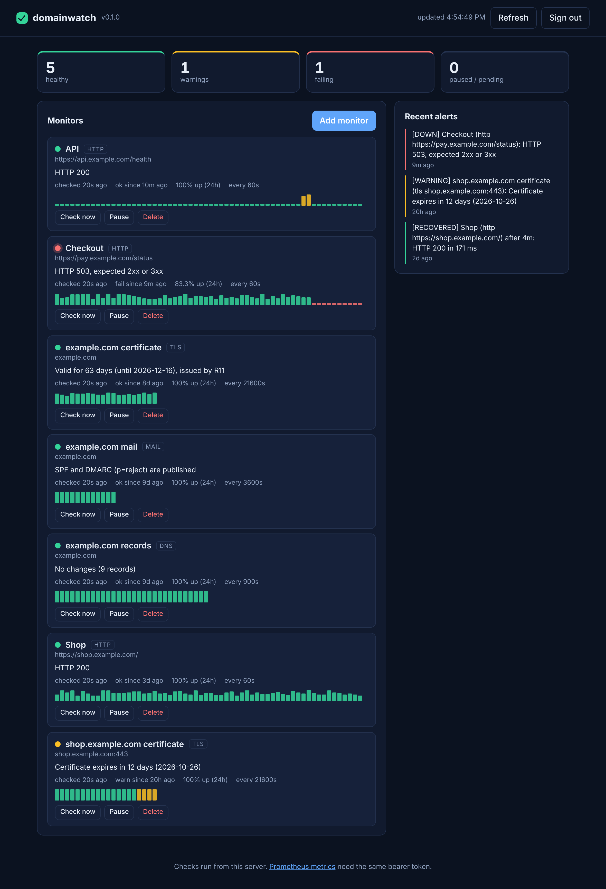

# domainwatch

[](https://github.com/ducampcarlos/domainwatch/actions/workflows/ci.yml)


[](LICENSE)

**A small self-hosted monitor for the things that break quietly: certificates that expire, sites that go down, DNS records that change, mail domains that lose SPF/DMARC.**
One process, one SQLite file, a dashboard, a JSON API, Prometheus metrics and webhooks for Slack, Discord or anything that takes a POST. **No runtime dependencies** (it uses Node's built-in `node:sqlite`, `node:tls`, `node:http` and `node:dns`).

<p align="center"></p>

<sub>The screenshots use demo data seeded into the database (`scripts/screenshots.mjs`); everything else on the page is the real dashboard.</sub>

## What it watches

| Kind | Target | Fails or warns when |
| --- | --- | --- |
| `tls` | `host` or `host:port` | the certificate is expired, expires within 7 days (fail) or 21 days (warn), is for another host name, is self-signed, or the server forgot its intermediate certificate |
| `http` | a URL | the status after redirects is not 200-399 (configurable), the request times out or is refused, redirects loop, or it is slower than 3 s (warn) |
| `dns` | a domain | any of A, AAAA, NS, MX, TXT or CAA changes from the last accepted baseline (the diff is in the alert: `A: +203.0.113.9 -203.0.113.7`) or the domain stops resolving |
| `mail` | a domain | SPF or DMARC is missing, duplicated or has no policy (fail), or is weak: `+all`, `?all`, `p=none` (warn) |

Intervals default to 6 h (tls), 1 min (http), 15 min (dns) and 1 h (mail); the minimum is 30 s.

## Quick start

```bash
docker build -t domainwatch .
docker run -d --name domainwatch -p 127.0.0.1:8787:8787 -v domainwatch-data:/data \
  -e DOMAINWATCH_TOKEN=$(openssl rand -hex 32) \
  -e DOMAINWATCH_WEBHOOKS=https://hooks.slack.com/services/XXX \
  domainwatch
```

or without Docker (Node 22.19+):

```bash
npm ci && npm run build
export DOMAINWATCH_TOKEN=$(openssl rand -hex 32)
npm start                       # http://127.0.0.1:8787
```

Open the dashboard, paste the token, add monitors. Or use the API:

```bash
T="Authorization: Bearer $DOMAINWATCH_TOKEN"
curl -H "$T" -H 'content-type: application/json' localhost:8787/api/monitors \
  -d '{"kind":"tls","target":"example.com","config":{"warnDays":30}}'
curl -H "$T" -H 'content-type: application/json' localhost:8787/api/monitors \
  -d '{"kind":"http","target":"https://example.com/health","intervalS":30,"config":{"expectStatus":[200]}}'
curl -H "$T" -X POST localhost:8787/api/monitors/1/run       # check right now
```

### One-off checks from the command line

`domainwatch check` runs a single check with the same rules and exits with a status you can use in scripts or CI: **0** ok, **1** warning, **2** failing, **64** usage error.

```console
$ domainwatch check http http://127.0.0.1:8080/health --allow-private
OK   http http://127.0.0.1:8080/health: HTTP 200 in 11 ms
$ domainwatch check http http://127.0.0.1:8080/ --allow-private      # exit status 2
FAIL http http://127.0.0.1:8080/: HTTP 503, expected 2xx or 3xx
$ domainwatch check http http://169.254.169.254/latest/meta-data/    # the target policy applies here too
FAIL http http://169.254.169.254/latest/meta-data/: 169.254.169.254 is a private or special-purpose address. Set DOMAINWATCH_ALLOW_PRIVATE=1 (or pass --allow-private to `check`) to monitor internal hosts
$ domainwatch check tls example.com --warn-days 30 --json
```

## How alerting works

A monitor is not paged on its first failed check. The state machine (`src/engine/alerts.ts`, a pure function with its own tests) works like this:

- **Two consecutive failures** are needed before a `down` alert, so a single dropped packet is not an incident. The dashboard shows that in-between state as an unconfirmed failure instead of pretending it is healthy.
- **Certificate problems skip the threshold** (an expired certificate will still be expired in a minute).
- A `recovered` alert says how long the outage lasted. A long outage repeats as `still_down` every 6 hours, not every check.
- A warning is announced once; DNS changes are announced every time the records change again.
- State is stored in the database, so a restart neither forgets an outage nor announces it a second time.
- Webhook delivery is retried (3 attempts, exponential backoff, no retry on a 4xx other than 429). If every receiver fails the alert stays visible in the dashboard marked as not delivered, and monitoring continues.

The webhook body carries both `text` (Slack, Mattermost) and `content` (Discord) plus a structured `event`:

```json
{ "text": "[DOWN] Shop (http https://shop.example.com/): HTTP 503, expected 2xx or 3xx",
  "content": "[DOWN] Shop (http ...)",
  "event": { "kind": "down", "ts": 1760000000, "message": "...", "monitor": { "id": 3, "name": "Shop", "kind": "http", "target": "https://shop.example.com/" } } }
```

## API

All routes except `/healthz` and the dashboard files need `Authorization: Bearer <token>`.

| Route | |
| --- | --- |
| `GET /healthz` | liveness, version, monitor count (no auth) |
| `GET /metrics` | Prometheus text format |
| `GET /api/summary` | counts, every monitor with state, last result and 24 h uptime, recent alerts |
| `GET, POST /api/monitors` | list, create |
| `GET, PATCH, DELETE /api/monitors/:id` | read, update `name` / `intervalS` / `enabled` / `config`, delete |
| `POST /api/monitors/:id/run` | run a check now (409 if one is already running) |
| `GET /api/monitors/:id/results?limit=` | history, newest first (default 100, max 1000) |
| `GET /api/alerts?limit=` | recent alerts |

Prometheus gets `domainwatch_up`, `domainwatch_status` (0 ok, 1 warn, 2 fail), `domainwatch_days_remaining`, `domainwatch_status_code`, `domainwatch_uptime_ratio_24h`, `domainwatch_check_duration_ms` and more, labelled by monitor, kind and target:

```yaml
scrape_configs:
  - job_name: domainwatch
    authorization: { credentials: <token> }
    static_configs: [{ targets: ["127.0.0.1:8787"] }]
```

## Configuration

| Variable | Default | |
| --- | --- | --- |
| `DOMAINWATCH_TOKEN` | required | at least 16 characters; `openssl rand -hex 32` |
| `HOST`, `PORT` | `127.0.0.1`, `8787` | the Docker image listens on `0.0.0.0` inside the container |
| `DOMAINWATCH_DATA` | `./data` | directory for `domainwatch.db` (created with mode 0700) |
| `DOMAINWATCH_WEBHOOKS` | none | comma-separated URLs |
| `DOMAINWATCH_ALLOW_PRIVATE` | off | allow monitoring loopback and private addresses |
| `DOMAINWATCH_RETENTION_DAYS` | `30` | results older than this are pruned hourly |
| `DOMAINWATCH_CONCURRENCY` | `4` | checks running at once |
| `DOMAINWATCH_MAX_MONITORS` | `200` | |

Invalid values stop start-up with a message naming the variable.

## Security model

A monitor is a request to a host somebody typed into an API, so a stolen token must not turn it into a way to scan the internal network.

- **Private targets are refused by default.** Names are resolved once, and *every* address must be public: loopback, RFC 1918, link-local (cloud metadata at `169.254.169.254`), CGNAT, multicast, documentation ranges and IPv6 forms that embed an IPv4 address (`::ffff:`, NAT64, 6to4) are rejected. The connection is then pinned to the address that was checked, so a second DNS answer cannot redirect it (DNS rebinding).
- **Every redirect hop is checked again**, so a public site cannot bounce the monitor to `http://169.254.169.254/`.
- The HTTP check **never reads the response body**; the socket is dropped after the headers.
- The API token is compared in constant time; 10 failures in a minute from one address are answered with 429 until the window ends. Bodies are capped at 16 KB, must be JSON, and unknown fields are rejected rather than ignored.
- The dashboard is served with `Content-Security-Policy: default-src 'none'; script-src 'self'; ...`, no inline script or style, no CORS headers, and renders every value with `textContent` (there is an end-to-end test with a hostile monitor name).
- No secrets are stored other than what you put in the environment; the database holds targets, results and alert text.

`DOMAINWATCH_ALLOW_PRIVATE=1` turns the target policy off for internal monitoring. Do that only if the token is as sensitive as network access to that segment.

## Limitations

- DNS checks use Node's resolver (c-ares) against the system's configured nameservers, so they do **not** read `/etc/hosts` (a monitor for `localhost` reports NXDOMAIN) and say nothing about DNSSEC.
- The HTTP check asserts on status and latency only, not on page content.
- Webhook URLs come from the environment, not the API, and are not subject to the private-address policy: they are operator-configured.
- It is a single process on one SQLite file. There is no clustering, and no authentication beyond one shared token.
- The API speaks plain HTTP. If you expose it beyond loopback, put a TLS-terminating reverse proxy in front.
- Checks run from one place; an outage between that place and your site looks like your site being down.

## Development

```bash
npm ci
npm run typecheck
npm test              # 179 unit and integration tests
npm run build && npm run test:e2e   # 12 end-to-end tests: real server, real Chromium
```

The suite runs on Node 22 and 24 in CI. Layout:

```
src/checks/     one observer per kind (no judgement)           src/engine/evaluate.ts   observation -> ok/warn/fail verdict
src/engine/     alert state machine, scheduler                 src/net/                 target policy, DNS client
src/api/        HTTP API, validation, metrics                  src/notify/              webhooks
src/db.ts       SQLite (node:sqlite)                           public/                  dashboard (no build step)
```

Checks observe and the evaluator judges, so every rule (thresholds, DNS diffs, SPF/DMARC verdicts) is a pure function tested without a network. The TLS tests build real certificate chains (expired, wrong name, self-signed, untrusted) with a small DER encoder over `node:crypto` and let Node's own TLS stack validate them, and the HTTP tests use real local servers, with the SSRF cases going through a resolver that returns public-looking addresses while the connection is redirected to localhost.

## License

MIT
